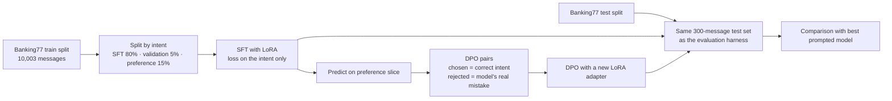

# Fine-Tuning a Small LLM for Banking Support

Fine-tune a 0.5-billion-parameter open model to classify bank customer messages into 77 intents, then test whether it beats prompting a much larger model, on accuracy, speed and cost.

**Stack:** Hugging Face Transformers · PEFT (LoRA) · TRL (SFT and DPO) · Qwen2.5-0.5B-Instruct · Google Colab (free T4 GPU) · pytest

## Results

> **Real-data results:** _run the Colab notebook and paste `results/comparison.md` here, with the loss curve._

| Model | Accuracy | Macro F1 | Invalid replies | Seconds / message | Cost / 1,000 messages |
| --- | --- | --- | --- | --- | --- |
| Qwen2.5-0.5B + LoRA (SFT) | _[X]_ | _[X]_ | _[X]_ | _[X]_ | _[X]_ |
| + DPO preference tuning | _[X]_ | _[X]_ | _[X]_ | _[X]_ | _[X]_ |
| Best prompted Gemini run (from the evaluation harness) | _[X]_ | _[X]_ | _[X]_ | _[X]_ | _[X]_ |

_Conclusion: when was fine-tuning worth it, and when would you prompt instead?_

## How it works



- **Model:** [Qwen2.5-0.5B-Instruct](https://huggingface.co/Qwen/Qwen2.5-0.5B-Instruct), small enough to fine-tune on a free Colab GPU. Change `--model` to try another.
- **SFT with LoRA:** only small adapter matrices are trained (rank 16 on all linear layers). Training examples are prompt/completion pairs, so the loss is computed on the intent name only, not on the instructions.
- **DPO (optional):** the SFT model is run on a held-out slice of the training data. Each mistake becomes a preference pair: the correct intent is "chosen" and the model's wrong answer is "rejected". DPO is a simpler alternative to RLHF that learns from these pairs directly, without a separate reward model.
- **Fair comparison:** the test set is drawn with the same stratified sampling and seed as the [LLM Evaluation Harness](../llm-eval-harness), so both projects score the same 300 messages. The test split is never used for training or for choosing settings.

## Run it

Open `notebooks/colab_finetune.ipynb` in Google Colab with a T4 GPU and run the cells. It installs the requirements, runs a short trial, then the full training, evaluation, optional DPO stage and upload to the Hugging Face Hub.

From a terminal with a GPU:

```bash
pip install -r requirements.txt
PYTHONPATH=src python -m bift.train_sft --out runs/sft
PYTHONPATH=src python -m bift.train_dpo --sft runs/sft --out runs/dpo
PYTHONPATH=src python -m bift.evaluate --runs runs/sft runs/dpo \
    --prompted ../llm-eval-harness/results/techniques/predictions.csv
```

Tests cover data splitting, formatting, label parsing, preference-pair building and scoring, and run without a GPU: `pip install -r requirements-test.txt && pytest`. The training scripts themselves need a GPU and were not run in CI.

## Design decisions

- **Loss on the answer only.** Training on the instructions too would spend capacity memorizing the system prompt.
- **Replies are mapped to labels, not trusted.** The model's reply is normalized and matched to the 77 intent names (with a strict typo tolerance); anything else counts as wrong.
- **Preference pairs from real mistakes.** Random wrong answers would teach little. The model's own errors target exactly the intents it confuses, and a cap per confusion stops one common mistake dominating.
- **Three-way split of the training data.** Validation catches overfitting, and the preference slice gives DPO mistakes the SFT model didn't see during training.
- **Cost is measured, not assumed.** Self-hosted cost is GPU time per 1,000 messages at the price you enter; prompted cost comes from the token counts in the evaluation harness.

## Limitations

- One base model and one training run; repeating with several seeds would show how stable the results are.
- Speed measured on a Colab T4 will differ from production hardware.

## Data and model licenses

[Banking77](https://huggingface.co/datasets/PolyAI/banking77): CC BY 4.0. Qwen2.5-0.5B-Instruct: see its model card on Hugging Face.
