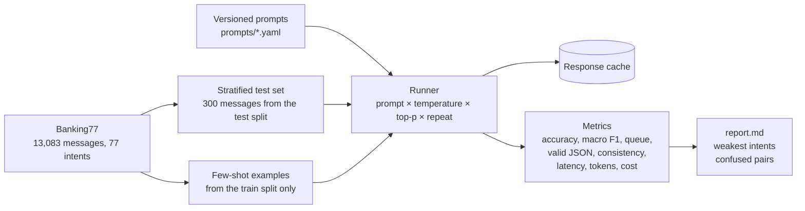

# LLM Evaluation Harness for Banking Support Triage

A reusable test harness that measures which prompting techniques and sampling settings actually work for routing bank customer messages, instead of judging a prompt by a few hand-picked examples.

Each message must be classified into one of 77 intents, routed to a team queue, and flagged if a person must review it. The model returns this as structured JSON, the same problem as customer complaint triage.

**Stack:** Python · Gemini 2.5 Flash (google-genai) · Hugging Face Datasets · pandas · scikit-learn · YAML-versioned prompts · pytest

## Results

> **Real-data results:** _run both experiments and paste `results/techniques/report.md` and `results/settings/report.md` highlights here._

| Prompt | Intent accuracy | Macro F1 | Queue accuracy | Valid JSON | Cost / 1,000 messages |
| --- | --- | --- | --- | --- | --- |
| Zero-shot | _[X]_ | _[X]_ | _[X]_ | _[X]_ | _[X]_ |
| Few-shot | _[X]_ | _[X]_ | _[X]_ | _[X]_ | _[X]_ |
| Few-shot chain-of-thought | _[X]_ | _[X]_ | _[X]_ | _[X]_ | _[X]_ |
| Role + few-shot | _[X]_ | _[X]_ | _[X]_ | _[X]_ | _[X]_ |

_Add the settings sweep (temperature × top-p, with consistency across 3 repeats), the weakest intents, the most-confused pairs, and your recommendation._

## How it works



- **Data:** [Banking77](https://huggingface.co/datasets/PolyAI/banking77) (CC BY 4.0). The 300 test messages are a stratified sample of the official test split, spread evenly across intents. Few-shot examples come only from the training split, so test messages never leak into prompts.
- **Routing:** `queues.py` groups the 77 intents into 8 queues (cards, transfers, top-ups, cash, foreign exchange, security, disputes, account). Security and dispute messages must be flagged for human review. Run `python -m evalharness.queues` to see and adjust the mapping.
- **Prompts:** four techniques from Weeks 3–4, each a versioned YAML file: zero-shot, few-shot, few-shot chain-of-thought, and role prompting.
- **Settings:** every run pins the model, temperature, top-p, max output tokens and stop sequences, and reports them next to the results.

## Metrics

| Metric | Why it matters |
| --- | --- |
| Intent accuracy, macro F1 | Macro F1 weights every intent equally, so rare intents can't hide behind common ones |
| Queue accuracy, needs-human accuracy | What actually affects the customer: right team, and a person on risky cases |
| Valid JSON, valid intent | A reply that can't be parsed is a production failure, not a near miss |
| Consistency | Share of messages where all repeats gave the same intent; shows what temperature does |
| p50 / p95 latency, tokens, cost per 1,000 messages | Chain-of-thought may be more accurate but slower and costlier |
| Accuracy by queue, weakest intents, confused pairs | Averages hide the failures that matter |

## Run it

```bash
pip install -r requirements.txt
export GEMINI_API_KEY=...
PYTHONPATH=src python -m evalharness.cli --config experiments/techniques.yaml   # 1,200 calls
# put the best prompt from step 1 into experiments/settings.yaml, then:
PYTHONPATH=src python -m evalharness.cli --config experiments/settings.yaml     # 1,800 calls
```

Responses are cached in `results/<experiment>/cache.jsonl`, so an interrupted run resumes where it stopped and re-running costs nothing. Check your API rate limits before starting; the client retries with backoff when it hits them. Fill in `price_per_million_input` and `price_per_million_output` from the current Gemini pricing page to get costs.

Tests use a small synthetic fixture and a scripted fake model, so they need no API key: `pip install -r requirements-test.txt && pytest`.

## Design decisions

- **Prompts are versioned files with a fingerprint.** Changing a prompt changes its fingerprint, so cached results from an old version are never mixed with new ones.
- **The test set is fixed and stratified.** Every configuration is scored on the same 300 messages, spread across intents, so differences come from the prompt or settings, not the sample.
- **Invalid output counts as wrong.** A malformed reply isn't dropped from the denominator; dropping it would make a worse prompt look better.
- **Repeats measure consistency.** A setting that gives different answers to the same message is a production risk even when its average accuracy looks fine.
- **The same test set is reused by the fine-tuning project**, so a fine-tuned small model can be compared directly against the best prompt.

## Limitations

- LLM accuracy on Banking77 depends on how similar some intents are; the confused-pairs table shows where the label set itself is ambiguous.
- The queue mapping is a rule-of-thumb grouping, not a real bank's routing policy.
