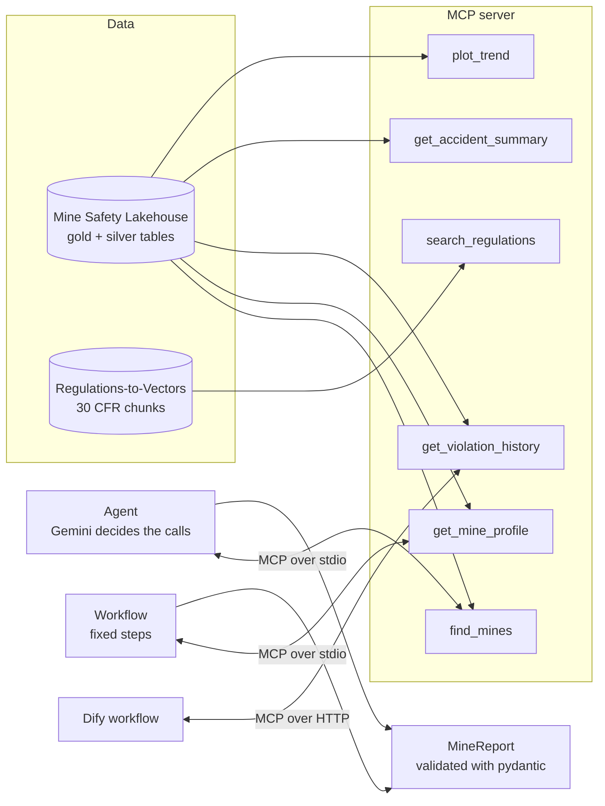

# Mine Operations Agent with a Custom MCP Server

An AI analyst that writes a structured safety report for any U.S. mine by calling tools I built and exposed through my own Model Context Protocol (MCP) server: mine profiles, violation history, accident summaries, regulation search and charts.

It compares two designs on the same mines:
- an **agent**, where the LLM decides which tools to call and when to stop;
- a **fixed workflow**, where the steps are hard-coded and the LLM only writes the report.

**Stack:** Python · MCP Python SDK (FastMCP) · Gemini 2.5 Flash tool calling · pydantic · pandas · rank-bm25 · matplotlib · pytest

## Results

> **Real-data results:** _run `python -m mineagent.compare` on 20 mines and paste `results/summary.md` here, with one example report._

| Design | Valid reports | Facts copied correctly | Invented citations | Tool calls / report | Tokens / report | Seconds / report |
| --- | --- | --- | --- | --- | --- | --- |
| Agent | _[X]_ | _[X]_ | _[X]_ | _[X]_ | _[X]_ | _[X]_ |
| Workflow | _[X]_ | _[X]_ | _[X]_ | _[X]_ | _[X]_ | _[X]_ |

_Add your conclusion: when is the agent's flexibility worth its extra cost and variability?_

## Architecture



## Tools

| Tool | Returns | Input checks |
| --- | --- | --- |
| `find_mines` | Mine IDs by state or name | limit 1–50 |
| `get_mine_profile` | Name, state, type, status, commodity, operator, employees | 7-digit mine ID (leading zeros restored) |
| `get_violation_history` | Per-quarter inspections, violations, S&S violations, penalties, with totals | quarters 1–40 |
| `get_accident_summary` | Accidents, injuries, days lost, serious accidents, top accident types and equipment | years 1–20 |
| `search_regulations` | Matching 30 CFR sections with titles, links and text | k 1–10, optional part |
| `plot_trend` | A PNG chart of one metric per quarter | allowed metrics only |

Bad input never crashes the server: it comes back to the model as an error message it can correct.

## Guardrails

- **Tool budget:** at most 12 tool calls per report; after that the model is told to write the report, and the run stops if it keeps calling tools.
- **No repeated calls:** an identical call is refused, with a reminder to use the earlier result.
- **Schema validation:** the report must match `MineReport` (pydantic). An invalid report gets one retry with the validation error.
- **Fact checking:** the comparison recomputes the true totals from the data and checks every number in the report.
- **Citation checking:** any regulation the report cites that the tools never returned is counted as invented.

## Run it

```bash
pip install -r requirements.txt
export GEMINI_API_KEY=...
# One report
PYTHONPATH=src python -m mineagent.cli <mine_id> \
    --data-dir ../mine-safety-lakehouse/lakehouse_data --regs-dir ../regs-to-vectors/vectors
# Agent vs workflow on 20 mines
PYTHONPATH=src python -m mineagent.compare \
    --data-dir ../mine-safety-lakehouse/lakehouse_data --regs-dir ../regs-to-vectors/vectors --mines 20
```

`--data-dir` needs the lakehouse tables `silver_mines`, `silver_accidents` and `gold_mine_quarterly_safety` as Parquet. Local mode of the lakehouse project writes them there directly. From Databricks, export them in a notebook and download the folder:

```python
import os
for t in ["silver_mines", "silver_accidents", "gold_mine_quarterly_safety"]:
    out = f"/Volumes/workspace/mine_safety/landing/export/{t}"
    os.makedirs(out, exist_ok=True)
    spark.table(f"workspace.mine_safety.{t}").toPandas().to_parquet(f"{out}/part-0.parquet")
```

To build the same workflow in Dify, see [docs/dify.md](docs/dify.md).

Tests use small synthetic tables and a scripted fake model, so they need no API key. They include a real MCP round trip: the server is started as a subprocess and called over stdio. Run `pip install -r requirements.txt pytest && pytest`.

## Design decisions

- **Tools return facts, the LLM writes prose.** Totals are computed in code and the model copies them, so the numbers can be verified.
- **One server, three clients.** The same MCP server serves the agent (stdio), the workflow (stdio) and Dify (HTTP); no tool logic is duplicated.
- **The comparison scores both designs on the same mines with the same model**, chosen to span low- and high-violation mines.
- **Time windows are relative to the latest data,** not today's date, so results don't change just because a day passed.

## Limitations

- Fact accuracy checks the four headline numbers, not every sentence of the summary.
- Regulation search here is keyword-only (BM25); the RAG project's hybrid retriever could be plugged in as the tool's backend.
