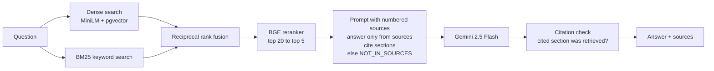

# Mine Safety Regulations RAG Assistant

A question-answering assistant over U.S. mine safety regulations (30 CFR) that cites the exact section behind every answer, and measures, with numbers, how much retrieval beats a plain LLM.

It compares five configurations: no retrieval (the LLM alone), dense search, BM25 keyword search, hybrid search, and hybrid search with a reranker. Each runs on two chunking strategies, scored on retrieval and answer quality.

**Stack:** Python · sentence-transformers (MiniLM embeddings, BGE reranker) · rank-bm25 · Gemini 2.5 Flash · PostgreSQL + pgvector · Streamlit · pytest

## Results

> **Real-data results:** _load the regulations with [Regulations-to-Vectors](../regs-to-vectors), write the 50-question set ([how](eval/README.md)), run the evaluation and paste `results/summary.md` here._

| Configuration | Chunks | Hit@5 | Recall@5 | MRR | Correct | Faithful | Correct "not in sources" |
| --- | --- | --- | --- | --- | --- | --- | --- |
| LLM alone (no RAG) | – | – | – | – | _[X]_ | – | _[X]_ |
| Dense | section | _[X]_ | _[X]_ | _[X]_ | _[X]_ | _[X]_ | _[X]_ |
| BM25 | section | _[X]_ | _[X]_ | _[X]_ | _[X]_ | _[X]_ | _[X]_ |
| Hybrid | section | _[X]_ | _[X]_ | _[X]_ | _[X]_ | _[X]_ | _[X]_ |
| Hybrid + rerank | section | _[X]_ | _[X]_ | _[X]_ | _[X]_ | _[X]_ | _[X]_ |

_Add three examples where the LLM alone hallucinated a rule and RAG answered correctly with a citation._

## Architecture



## What's measured

| Metric | Meaning | Needs an LLM? |
| --- | --- | --- |
| Hit@5 | A correct section is in the top 5 | No |
| Recall@5 | Share of the correct sections retrieved; matters for multi-section questions | No |
| MRR | How high the first correct section ranks | No |
| Correct | An LLM judge compares the answer with the reference answer | Yes |
| Faithful | An LLM judge checks every claim is supported by the retrieved sources | Yes |
| Citation OK | Every section the answer cites was actually retrieved | Yes |
| Correct "not in sources" | Unanswerable questions are refused instead of invented | Yes |
| BERTScore F1 | Meaning overlap with the reference answer | Yes |

Retrieval metrics cost nothing to run, so you can compare retrievers and chunking strategies as often as you like before spending API calls on answers.

## Run it

```bash
pip install -r requirements.txt

# 1. Build the corpus with the Regulations-to-Vectors project (pgvector or a local folder)
# 2. Retrieval-only comparison (free):
PYTHONPATH=src python -m msrag.evaluate --corpus local:../regs-to-vectors/vectors \
    --questions eval/questions.jsonl
# 3. Full comparison with answers, adding the LLM-alone baseline:
export GEMINI_API_KEY=...
PYTHONPATH=src python -m msrag.evaluate --corpus local:../regs-to-vectors/vectors \
    --questions eval/questions.jsonl --with-answers
# 4. The app:
CORPUS=local:../regs-to-vectors/vectors streamlit run app.py
```

Tests run without any model or API key: they use a word-hashing stand-in for embeddings and a scripted fake LLM.

```bash
pip install -r requirements-test.txt && pytest
```

## Design decisions

- **Hybrid search with reciprocal rank fusion.** Regulations mix exact identifiers ("§ 75.400", "float coal dust") with plain-language questions. BM25 catches the identifiers and dense search catches paraphrases. RRF combines them using ranks only, so their very different score scales don't matter.
- **The tokenizer keeps section numbers whole.** A default tokenizer splits "75.400" into "75" and "400", which match hundreds of unrelated chunks.
- **Rerank only the top 20.** A cross-encoder is accurate but slow, so it re-scores a short list instead of the whole corpus.
- **Refuse rather than guess.** The prompt requires `NOT_IN_SOURCES` when the sources don't answer the question, and unanswerable questions in the evaluation set measure whether that works.
- **Check citations in code.** Every cited section is compared against what was retrieved; a citation to a section that wasn't retrieved is flagged as invented.
- **Retrieval measured separately from generation.** When an answer is wrong, the metrics show whether retrieval missed the rule or the LLM misused it.

## Limitations and next steps

- LLM-as-judge scores should be spot-checked against your own judgement on a sample of answers.
- Multi-section questions may need query decomposition or multi-hop retrieval (Week 6).
- Domain-tuning the embedding model on regulatory language could improve dense retrieval.

This is a learning project, not legal or compliance advice.
