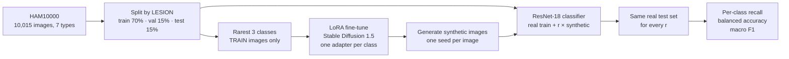

# Diffusion Data Augmentation for Skin Lesion Classification

Can synthetic images from a diffusion model help a classifier recognize **rare** skin lesion types? This project fine-tunes Stable Diffusion on the rarest classes in HAM10000, generates synthetic examples, and measures the effect on a classifier at several amounts of synthetic data.

> This is a learning project about data augmentation. It is **not** a diagnostic tool and must not be used for medical decisions.

**Stack:** PyTorch · torchvision (ResNet-18) · Hugging Face Diffusers (Stable Diffusion 1.5 + LoRA) · scikit-learn · Google Colab (T4 GPU) · pytest

## Results

> **Your results:** _run the Colab notebook and paste `work/results/experiment.md` and `work/results_grid.png` here._

| Synthetic images per real rare-class image | Rare-class recall | Balanced accuracy | Macro F1 | Accuracy |
| --- | --- | --- | --- | --- |
| 0 (real only, baseline) | _[X]_ | _[X]_ | _[X]_ | _[X]_ |
| 0.5 | _[X]_ | _[X]_ | _[X]_ | _[X]_ |
| 1 | _[X]_ | _[X]_ | _[X]_ | _[X]_ |
| 2 | _[X]_ | _[X]_ | _[X]_ | _[X]_ |

_Add your conclusion: did synthetic images help the rare classes, at what amount did it stop helping, and did the common classes suffer?_

## How it works



- **Data:** [HAM10000](https://datasetninja.com/skin-cancer-ham10000), 10,015 dermatoscopic images of 7 lesion types, heavily imbalanced toward common moles (CC BY-NC 4.0; credit Tschandl et al., Medical University of Vienna and University of Queensland).
- **Splits by lesion, not image.** Some lesions were photographed several times; splitting by image would leak near-identical photos from train into test and inflate every score.
- **Diffusion model:** Stable Diffusion 1.5 with a LoRA adapter trained per rare class using the official diffusers training script. Only training images are used, so synthetic images can't copy test images.
- **Classifier:** ResNet-18 fine-tuned from ImageNet weights, keeping the epoch with the best validation balanced accuracy.
- **Experiment:** for ratios r = 0, 0.5, 1 and 2, add r synthetic images per real image of each rare class. Validation and test are always the same real images. Each ratio can be repeated with several seeds.

## Why these metrics

A model that labels everything "melanocytic nevus" is about two-thirds accurate on HAM10000 and useless. So the main metric is **rare-class recall** (the share of rare lesions correctly identified), alongside balanced accuracy and macro F1, which weight every class equally. Plain accuracy is reported only to show how misleading it is.

## Run it

Open `notebooks/colab_experiment.ipynb` in Google Colab with a T4 GPU and run the cells: download, prepare, LoRA training, generation, the image grid, and the experiment.

Command line equivalents (GPU needed for training and generation):

```bash
PYTHONPATH=src python -m sld.prepare --root data/ham10000 --out work
# LoRA training: see the notebook (official diffusers script, one run per rare class)
PYTHONPATH=src python -m sld.generate --lora work/lora/df --dx df --n 150
PYTHONPATH=src python -m sld.experiment --work work --ratios 0 0.5 1 2 --seeds 0 1
```

**Tests** cover the lesion-level split (no leakage), the train-only diffusion sets, how many synthetic images each ratio adds, and the metrics. They run without a GPU: `pip install -r requirements-test.txt && pytest`. The GPU steps themselves were not run in CI.

## Design decisions

- **One LoRA adapter per class** keeps each class's style separate and makes it cheap to retrain one class.
- **Synthetic images only ever go into training.** Evaluating on synthetic images would measure how well the classifier recognizes the generator, not lesions.
- **Ratios are relative to each class's real count,** so rare classes get proportionally more help.
- **Multiple seeds per ratio** show whether a difference is real or just training noise.

## Limitations and ethics

- Synthetic medical images can look plausible while lacking real clinical features; a dermatologist should review samples before drawing conclusions.
- HAM10000 skews toward lighter skin tones, so results may not hold across skin types.
- The non-commercial license means this work can't be used in a commercial product.
